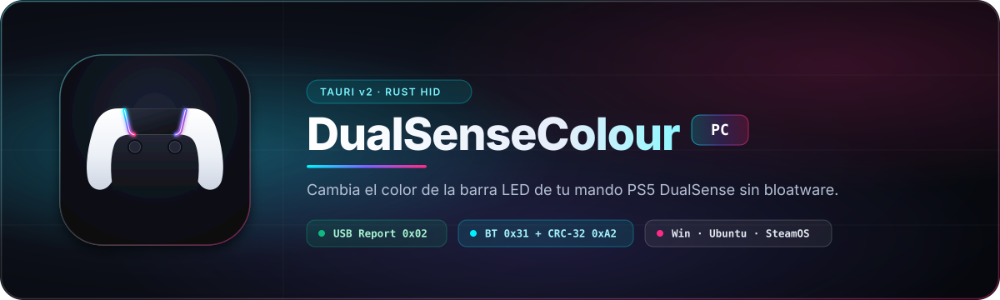

<div align="center">



# DualSenseColour PC

**Controla la barra de luz RGB, los LEDs de jugador y el indicador de micrófono de tu mando PS5 DualSense desde Windows, Linux y SteamOS sin instalar pesados gestores de juegos.**

[](https://github.com/Ignaciobrenas/DualSenseColour-PC/actions/workflows/ci.yml)
[](LICENSE)
[](https://tauri.app/)
[](docs/LINUX_STEAMOS_SETUP.md)

</div>

---

## ¿Por qué nace este proyecto?

> **Esta herramienta nace porque simplemente quería poder cambiar el color de la luz de mi mando de PS5.**

En PC, los mandos DualSense estándar y DualSense Edge suelen quedar bloqueados con un azul tenue genérico (o con la luz completamente apagada) fuera de juegos concretos. Las alternativas habituales obligan a instalar drivers virtuales pesados, servicios en segundo plano con alto consumo de RAM o suites completas llenas de funciones que no necesitas si solo quieres elegir el color de tu mando.

**DualSenseColour PC** resuelve exactamente ese problema con una filosofía directa:
- Binario nativo ligero con backend en **Rust** (`hidapi` directo a HID) e interfaz **Tauri v2** estilo glassmorphism.
- Cero drivers virtuales intrusivos ni secuestro del dispositivo XInput/DirectInput.
- Consumo despreciable en reposo (~0% CPU) y permanencia discreta en el System Tray.

---

## Características Principales

- **Protocolo HID DualSense completo**:
  - **USB (`Output Report 0x02`, 63 bytes)**: respuesta instantánea con escalado de brillo hardware y cero latencia.
  - **Bluetooth (`Output Report 0x31`, 78 bytes)**: cálculo exacto de **CRC-32 (IEEE 802.3 con semilla `0xA2`)**, secuencia circular de 4 bits y apertura nativa automática mediante Feature Report `0x05`/`0x20`.
  - Compatible con **DualSense (`054C:0CE6`)** y **DualSense Edge (`054C:0DF2`)**.
- **Vista previa realista en tiempo real**: render cenital de alta definición del DualSense con iluminación LED reactiva, halo ambiental dinámico, los 5 LEDs de jugador e indicador de mute de micrófono.
- **Paleta RGB completa + 6 presets oficiales + Apagar LED**:
  - `PlayStation Blue` (`#00439C`)
  - `Crimson Red` (`#FF1744`)
  - `Cyber Cyan` (`#00F0FF`)
  - `Emerald` (`#00E676`)
  - `Gold` (`#FFD600`)
  - `Violet` (`#9D4EDD`)
  - Botón directo `Apagar LED` (`#000000`)
- **LEDs de jugador (1–5) y LED de micrófono**: enciende de 0 a 5 LEDs indicadores inferiores con patrón oficial Sony y alterna el LED ámbar del botón Mute (`Apagado`, `Encendido`, `Pulso`).
- **Hotplug y memoria persistente**: guarda tus preferencias en JSON y reaplica tu color automáticamente en < 1.5 s cada vez que conectas o despiertas el mando por cable o Bluetooth.
- **System Tray + Keep-Alive SteamOS**: acceso rápido a tus presets favoritos desde la bandeja del sistema y modo *Keep-Alive* para mantener tu color frente a resets de Steam Input.

---

## Instalación por Plataforma

### Windows 10 / 11
1. Descarga el último instalador `.exe` / `.msi` o ejecutable portable desde [**GitHub Releases**](https://github.com/Ignaciobrenas/DualSenseColour-PC/releases).
2. No requiere drivers externos (usa el subsistema HID nativo de Windows).
3. Conecta tu DualSense por USB-C o Bluetooth y abre **DualSenseColour PC**.

### Ubuntu 26.04 LTS (Wayland) y derivados Debian
Instala las dependencias de sistema necesarias y las reglas `udev` para acceder a `hidraw` sin `root`:

```bash
sudo apt update
sudo apt install -y libwebkit2gtk-4.1-0 libayatana-appindicator3-1 libhidapi-hidraw0
sudo ./packaging/linux/install-udev.sh
```

Si ejecutas bajo una sesión Wayland con ciertos drivers NVIDIA/DMABUF, consulta [`docs/LINUX_STEAMOS_SETUP.md`](docs/LINUX_STEAMOS_SETUP.md) (`WEBKIT_DISABLE_DMABUF_RENDERER=1`).

### SteamOS / Steam Deck
Consulta la guía específica en [`docs/LINUX_STEAMOS_SETUP.md`](docs/LINUX_STEAMOS_SETUP.md) para instalar la AppImage y aplicar las reglas `udev` en `/etc/udev/rules.d/` sin tocar el sistema de archivos inmutable.

---

## Documentación Técnica

- [**PROTOCOL_HID.md**](docs/PROTOCOL_HID.md) — Especificación exacta de los reportes HID `0x02` (USB) y `0x31` (Bluetooth), flags de validez, bitmasks de Player LEDs y CRC-32 `0xA2`.
- [**LINUX_STEAMOS_SETUP.md**](docs/LINUX_STEAMOS_SETUP.md) — Configuración `udev`, dependencias de Ubuntu 26.04 Wayland y notas para Steam Deck / SteamOS.

---

## Desarrollo y Testing Local

Requisitos previos: **Node.js 20+**, **Rust stable** (`fmt` y `clippy` incluidos) y dependencias de Tauri v2 para tu sistema operativo.

```bash
# 1. Instalar dependencias del frontend
npm install

# 2. Calidad y tests del frontend
npm run lint
npm run typecheck
npm test
npm run build

# 3. Calidad y tests del backend Rust (HID + CRC-32 + Monitor Mock)
cd src-tauri
cargo fmt --check
cargo clippy --all-targets -- -D warnings
cargo test

# 4. Ejecutar aplicación completa en desarrollo
cd ..
npm run tauri dev
```

---

## Flujo de Contribución

El proyecto utiliza **GitHub Flow** con integración previa en `staging`:
1. Crea una rama desde `staging` (`feat/issue-<N>-<slug>`, `fix/...`, `docs/...`).
2. Sigue **Conventional Commits** referenciando la issue (`closes #<N>`).
3. Abre una Pull Request hacia `staging` asegurándote de que CI (`lint`, `typecheck`, `vitest`, `cargo fmt`, `cargo clippy`, `cargo test`) pasa en verde.

---

<div align="center">
  Hecho con 🦀 Rust + ⚛️ React + 💙 Tauri v2 · Licencia <a href="LICENSE">MIT</a>
</div>
