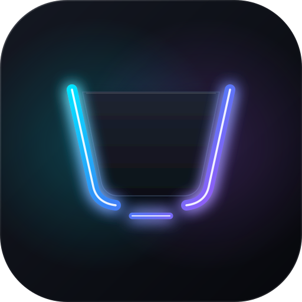
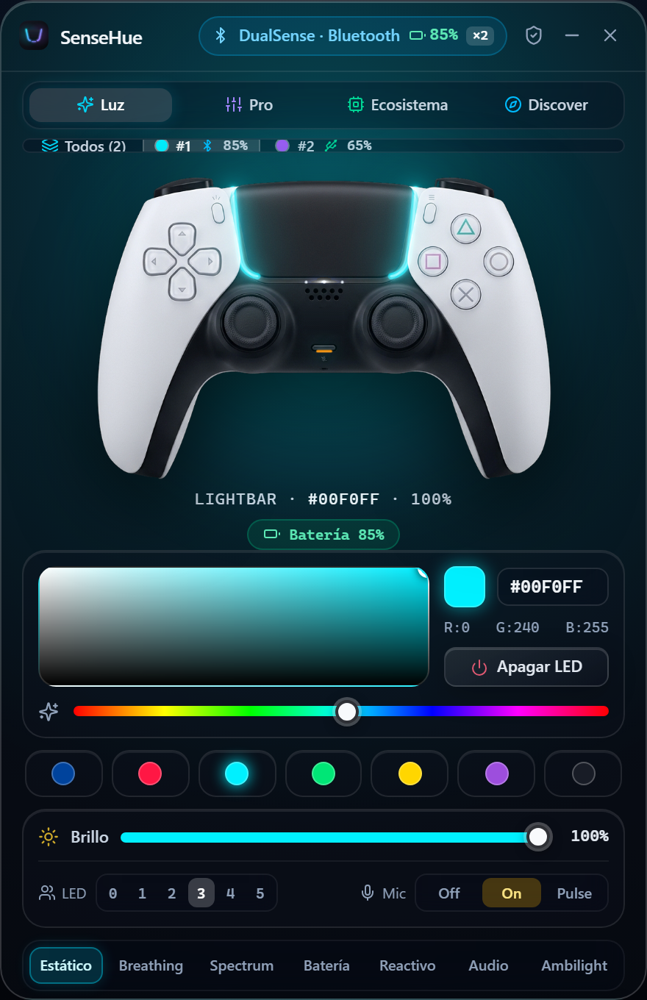
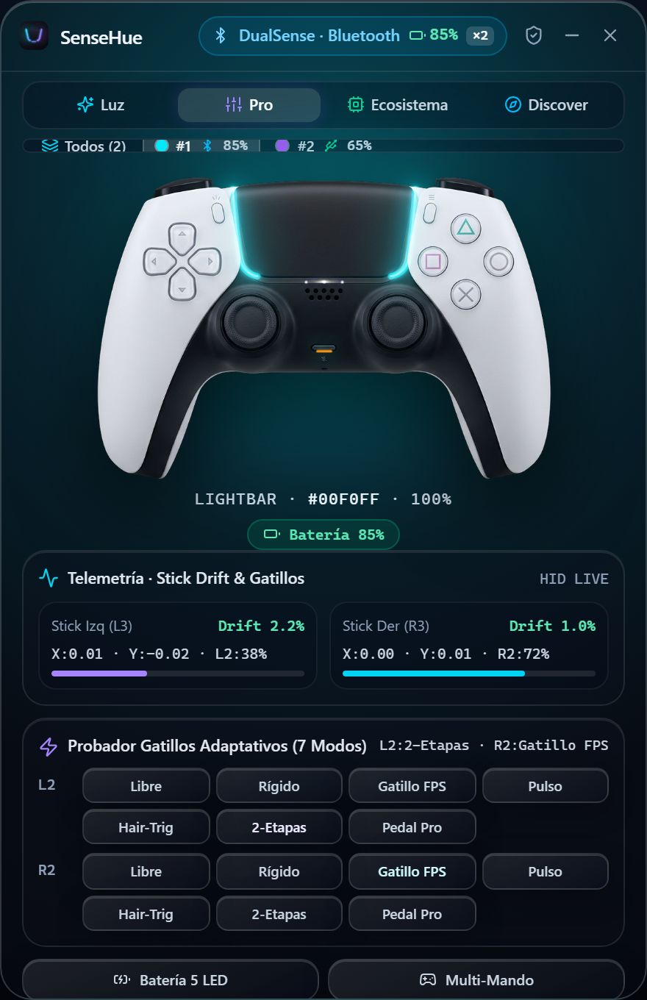
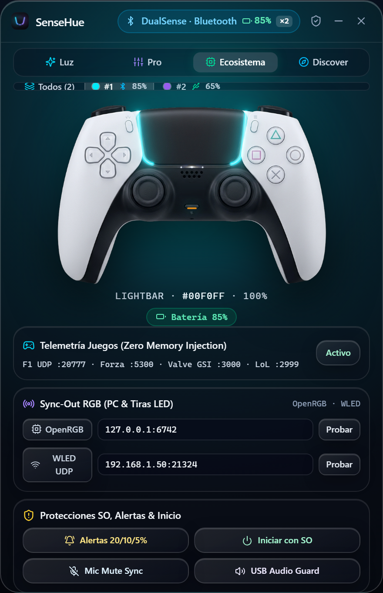
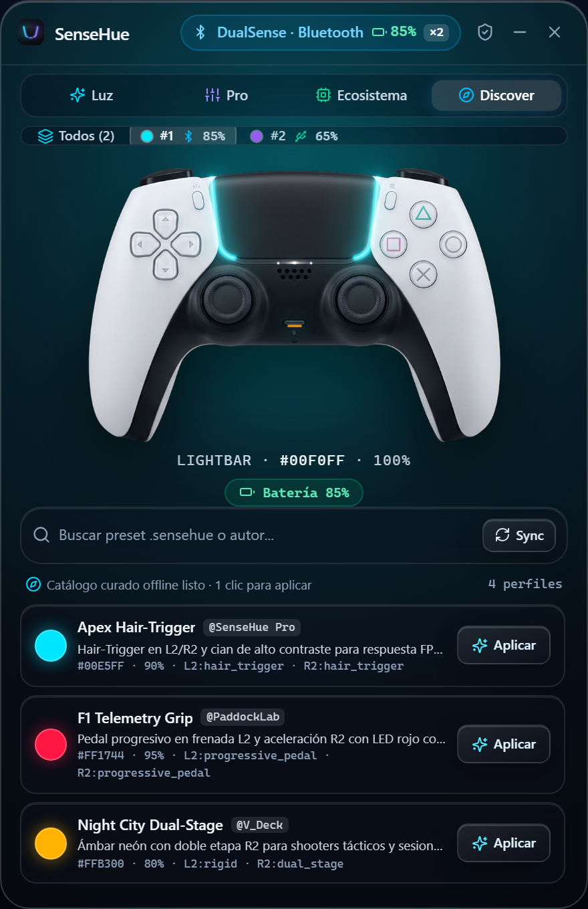
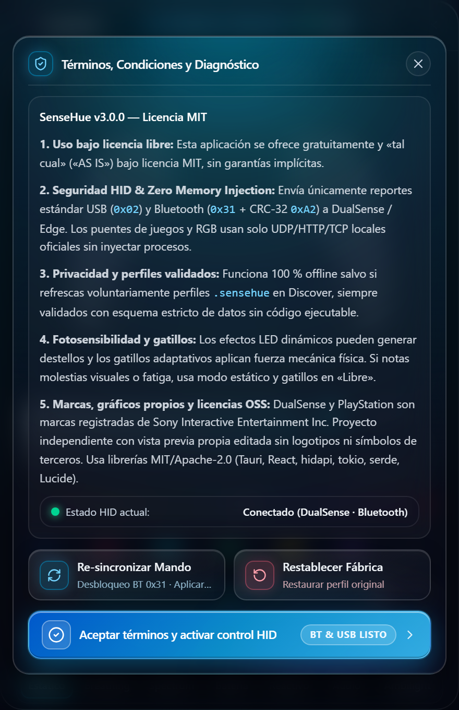
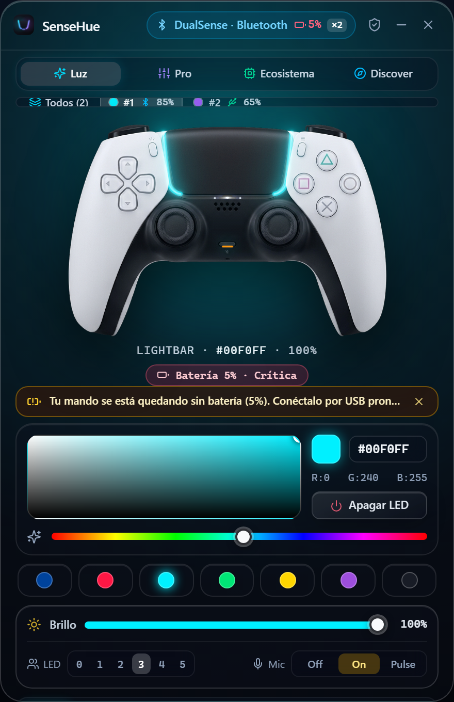

<div align="center">



# SenseHue v3.0.0

**Ultra-Light DualSense & DualSense Edge RGB Lighting, Real Battery Telemetry & Adaptive Trigger Suite**

*Built with Rust, Tauri v2, React 18, and Native `hidapi` for Windows, Linux & SteamOS*

[](./LICENSE)
[](./docs/DOCUMENTATION.en.md)
[](./docs/DOCUMENTATION.es.md)
[](./docs/PROTOCOL_HID.md)

[English Documentation](./docs/DOCUMENTATION.en.md) · [Documentación en Español](./docs/DOCUMENTATION.es.md) · [HID Protocol Spec](./docs/PROTOCOL_HID.md) · [Linux & SteamOS Setup](./docs/LINUX_STEAMOS_SETUP.md)

</div>

---

## Visual Tour — Every Section of SenseHue

<table>
  <tr>
    <td align="center" width="33%">
      <br/>
      <strong>1. Luz (Lighting & HSV Studio)</strong><br/>
      <sub>Live logo-free controller preview, 2D HSV picker, 7 curated presets, Player LEDs (0–5), Mic LED & 7 dynamic effects.</sub>
    </td>
    <td align="center" width="33%">
      <br/>
      <strong>2. Pro (Telemetry & Triggers)</strong><br/>
      <sub>Real-time HID stick drift (L3/R3), analog L2/R2 travel, and 7 independent adaptive trigger profiles per trigger.</sub>
    </td>
    <td align="center" width="33%">
      <br/>
      <strong>3. Ecosistema (Zero-Injection Sync)</strong><br/>
      <sub>Local game telemetry (F1, Forza, Valve GSI, LoL), OpenRGB / WLED sync, OS autostart & USB Audio Guard.</sub>
    </td>
  </tr>
  <tr>
    <td align="center" width="33%">
      <br/>
      <strong>4. Discover (<code>.sensehue</code> Hub)</strong><br/>
      <sub>Searchable curated community presets (100% offline-ready & schema-validated JSON only).</sub>
    </td>
    <td align="center" width="33%">
      <br/>
      <strong>5. Acerca de & HID Recovery</strong><br/>
      <sub>Live transport diagnostics, one-click Bluetooth 0x31 re-sync, factory reset, and MIT/trademark notices.</sub>
    </td>
    <td align="center" width="33%">
      <br/>
      <strong>6. Real Battery & Smart Alerts</strong><br/>
      <sub>Decodes true USB/BT hardware battery (20% / 10% / 5%) with dismissible banners (<code>X</code> or auto-close in 5s).</sub>
    </td>
  </tr>
</table>

---

## Why SenseHue v3.0.0?

- **True DualSense & DualSense Edge Support (`0x054C:0x0CE6` & `0x054C:0x0DF2`)**:
  Direct HID packets in pure Rust for **USB (`0x02`, 63 bytes)** and **Bluetooth (`0x31`, 78 bytes + IEEE CRC-32 seed `0xA2`)** with automatic **`Feature Report 0x05` / `0x20`** extended-mode wakeup.
- **Multi-Controller Hub + Single-Instance Lock**:
  Prevents duplicate desktop instances (`tauri-plugin-single-instance`) while detecting **all** connected USB and Bluetooth controllers simultaneously — configure `#1`, `#2`, etc. independently or toggle `Todos` to sync everything together.
- **Real Hardware Battery Telemetry & Dismissible Alerts**:
  Reads raw battery nibbles from `Input Report 0x01` (byte `53`) and extended `0x31` (byte `54`), drives optional 5-LED battery indicator bars, updates tray tooltips, and fires 20% / 10% / 5% low-battery alerts (close via **`X`** or auto-dismiss after **5s**).
- **7 Adaptive Trigger Modes (L2 & R2 Independent)**:
  `Libre` (`0x05` full motor release), `Rígido`, `Gatillo FPS`, `Pulso`, `Hair-Trig`, `2-Etapas`, and `Pedal Pro`, with synchronous & sequential frontend guards so rapid clicks always apply and reset cleanly.
- **Zero Memory Injection Game & RGB Ecosystem**:
  Reads only official local sockets/APIs (**F1 UDP `:20777`**, **Forza `:5300`**, **Valve GSI `:3000`**, **LoL Live `:2999`**), syncs external setups via **OpenRGB (`TCP :6742`)** and **WLED (`UDP :21324`)**, and includes an optional disabled-by-default loopback API (`127.0.0.1:17420`).
- **Branded Windows NSIS Installer, Portable App & CLI**:
  Custom dark branded NSIS installer (`SenseHue_3.0.0_x64-setup.exe`), standalone `SenseHue.exe`, and scriptable `sensehue-cli.exe`.

---

## Documentation

| Language / Idioma | Complete Guide | Contents |
| :--- | :--- | :--- |
| **English** | **[docs/DOCUMENTATION.en.md](./docs/DOCUMENTATION.en.md)** | Installation, every UI tab, multi-controller & single-instance, BT/USB battery decoding, adaptive trigger opcodes, CLI reference, architecture & troubleshooting |
| **Español** | **[docs/DOCUMENTATION.es.md](./docs/DOCUMENTATION.es.md)** | Guía completa en español: instalación, capturas comentadas de todos los apartados, multi-mando, batería real, 7 modos de gatillos, CLI, arquitectura y solución de problemas |
| **HID Spec (ES)** | **[docs/PROTOCOL_HID.md](./docs/PROTOCOL_HID.md)** | Byte-by-byte USB `0x02` / BT `0x31` report specification, CRC-32 `0xA2`, adaptive triggers & player LED bitmasks |
| **Linux / SteamOS** | **[docs/LINUX_STEAMOS_SETUP.md](./docs/LINUX_STEAMOS_SETUP.md)** | Udev rules (`99-sensehue.rules`), Steam Deck & desktop permissions |

---

## Quick Start

### Windows (`x86_64`)
1. Download **`SenseHue_3.0.0_x64-setup.exe`** (custom SenseHue installer) or **`SenseHue.exe`** (portable) from [GitHub Releases](https://github.com/Ignaciobrenas/SenseHue/releases).
2. Connect your DualSense or DualSense Edge via **USB-C** or **Bluetooth**.
3. Launch **SenseHue** — pick presets, tune HSV color, test adaptive triggers, or check real battery health right away.

### CLI Usage (`sensehue-cli`)

```powershell
sensehue-cli --status                              # Inspect connected pads, transport & real battery %
sensehue-cli --preset cyber-cyan                   # Apply curated preset
sensehue-cli --color "#FF1744" --brightness 80     # Set custom HEX color & brightness
sensehue-cli --mode battery                        # Switch effect (static, breathing, spectrum, battery, input, audio, ambilight)
sensehue-cli --off                                 # Turn off lightbar LEDs
```

---

## Development & Building from Source

### Prerequisites
- **Node.js 20+** and **npm**
- **Rust toolchain** (`1.77+`) + Tauri v2 system dependencies (`WebView2` on Windows; `webkit2gtk`, `libudev`, `libappindicator` on Linux)

```bash
# 1. Install frontend dependencies
npm install

# 2. Run quality checks (Frontend + Rust)
npm run lint
npm run typecheck
npm test
cargo test --manifest-path src-tauri/Cargo.toml

# 3. Launch live development window
npm run tauri dev

# 4. Build production desktop installer (NSIS on Windows) & CLI binary
npm run tauri build
cargo build --manifest-path src-tauri/Cargo.toml --release --bin sensehue-cli
```

---

## Legal, Trademarks & Safety

- **MIT License**: Provided *"AS IS"*, without warranties of any kind. See [LICENSE](./LICENSE) and [TERMS_AND_CONDITIONS.txt](./TERMS_AND_CONDITIONS.txt).
- **Trademarks**: "PlayStation", "PS5", and "DualSense" are registered trademarks of Sony Interactive Entertainment Inc., referenced strictly for descriptive compatibility (nominative fair use). **SenseHue** is an independent open-source utility and is **not** affiliated with, endorsed by, or sponsored by Sony Interactive Entertainment Inc. No official Sony/PlayStation brand logos are included.
- **Photosensitivity & Adaptive Triggers**: Rapid lighting animations and physical trigger resistance may cause discomfort for sensitive users; switch to **Estático** / **Libre** immediately if needed.
