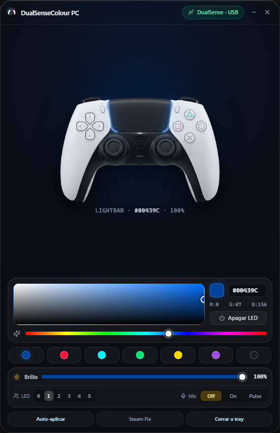

<p align="center">
  
</p>

<p align="center">
  <a href="https://github.com/Ignaciobrenas/SenseHue/releases">
    
  </a>
  
  
  <a href="LICENSE">
    
  </a>
</p>

> **DualSense Lighting & Telemetry** — A lightweight, ultra-fast desktop & SteamOS suite written in **Rust + Tauri v2 + React** to control RGB lighting, live battery telemetry, adaptive triggers, dynamic lighting effects, in-game hardware combos, and CLI automation for **Sony PlayStation 5 DualSense** (`0x054C:0x0CE6`) and **DualSense Edge** (`0x054C:0x0DF2`) over **USB-C** and **Bluetooth**.

---

## Preview

<p align="center">
  
</p>

---

## Key Features

- **Real-time Visual DualSense Preview**: High-resolution controller render with pixel-aligned optical touchpad lightbar glow, ambient halo, 5 Player LEDs, and Mic Mute LED indicator.
- **Responsive Color Picker & Curated Presets**: Interactive 2D Saturation/Value surface, full-spectrum Hue slider, HEX/RGB live inputs, brightness scaling, and quick presets (*PlayStation Blue, Crimson, Cyan, Emerald, Amber, Violet, Off*).
- **Native USB & Bluetooth HID Protocol (With BT `0x31` Unlock)**: Sends hardware output reports directly (`0x02` over USB, `0x31` + `valid_flag2=0x02` / `lightbar_setup=0x02` unlock flags & IEEE CRC-32 seed `0xA2` over Bluetooth) at smooth ~45 Hz IPC throttling without blocking the UI.
- **Battery Telemetry & Gamer Effects Suite (v2.0)**: Input report telemetry parser (`0%–100%`, charging status, stick drift & circularity), Adaptive Trigger presets, async `EffectEngine` (*Breathing, Prism Flow, Battery Smart, Input Reactive, Audio Beat, Screen Ambilight*), `GameWatcher` profile matcher, and debounced hardware combos (`Mute + D-Pad`).
- **`sensehue-cli` Companion Tool**: Scriptable command-line control (`--preset`, `--color`, `--brightness`, `--mode`, `--off`, `--status`) for Steam launch options and hotkeys.
- **Steam Keep-Alive Fix & System Tray**: Periodic LED state refresh option and rich native Windows/Linux System Tray controls (`Hide to Tray`).
- **Frameless Obsidian Glassmorphism Window**: Native Windows Acrylic/Mica backdrop integration with bespoke translucent glass controls.

---

## Supported Controllers

| Model | Vendor ID | Product ID | USB-C (`0x02`) | Bluetooth (`0x31` + CRC-32) |
| :--- | :---: | :---: | :---: | :---: |
| **Sony DualSense** (`CFI-ZCT1W`) | `0x054C` | `0x0CE6` | Supported | Supported |
| **Sony DualSense Edge** (`CFI-ZCP1`) | `0x054C` | `0x0DF2` | Supported | Supported |

---

## Installation

### Windows 10 / 11
1. Download the latest release binary or installer from the [GitHub Releases page](https://github.com/Ignaciobrenas/SenseHue/releases).
2. Plug in your DualSense via USB-C or pair it via Bluetooth, then launch `SenseHue`.

### Linux (Ubuntu 26.04 / Arch / Fedora / Wayland)
Non-root users require `udev` permissions for `/dev/hidraw*` devices (`054c:0ce6` and `054c:0df2`). Run the bundled installer script:

```bash
chmod +x packaging/linux/install-udev.sh
sudo ./packaging/linux/install-udev.sh
```

Then unplug and reconnect your controller (or reload via `sudo udevadm trigger`). For Wayland WebKitGTK troubleshooting (`WEBKIT_DISABLE_DMABUF_RENDERER=1 sensehue`), read the [Linux & SteamOS Setup Guide](docs/LINUX_STEAMOS_SETUP.md).

### SteamOS / Steam Deck
1. Switch to **Desktop Mode**.
2. Install the [AppImage](https://github.com/Ignaciobrenas/SenseHue/releases) or install the udev rules from [packaging/linux/99-sensehue.rules](packaging/linux/99-sensehue.rules).
3. Add **SenseHue** to Steam as a Non-Steam Game if you want quick access from **Gaming Mode** alongside the **Steam Fix** toggle or use `sensehue-cli` in launch options.

---

## Architecture & Technical Documentation

- **Backend (`src-tauri/src/`)**: Rust (`hidapi`, `crc32fast`, `thiserror`, `tokio`, `serde`, `window-vibrancy`) with trait-based HID transport abstraction so every protocol encoder, input report parser, effect engine, automation state machine, and config serializer is verified offline with mocks.
- **Frontend (`src/`)**: React 18, TypeScript, Tailwind CSS v4, Vitest + React Testing Library, and zero-dependency SVG optical lightbar rendering.
- **Specs**:
  - [DualSense HID Protocol Reference](docs/PROTOCOL_HID.md)
  - [Linux & SteamOS Setup Guide](docs/LINUX_STEAMOS_SETUP.md)

---

## Development & Building from Source

### Prerequisites
- [Node.js](https://nodejs.org/) 20+
- [Rust](https://rustup.rs/) stable toolchain
- On Linux: `libudev-dev`, `libwebkit2gtk-4.1-dev`, `libappindicator3-dev`, `librsvg2-dev`, `patchelf`

### Commands

```bash
# Install frontend dependencies
npm install

# Run full desktop app in dev mode (React + Rust backend)
npm run tauri dev

# Frontend quality gate
npm run lint
npm run typecheck
npm test
npm run build

# Rust quality gate (from src-tauri/)
cd src-tauri
cargo fmt --check
cargo clippy --all-targets -- -D warnings
cargo test
cargo build --release
```

---

## License

Distributed under the **MIT License**. See [LICENSE](LICENSE) for full details.
