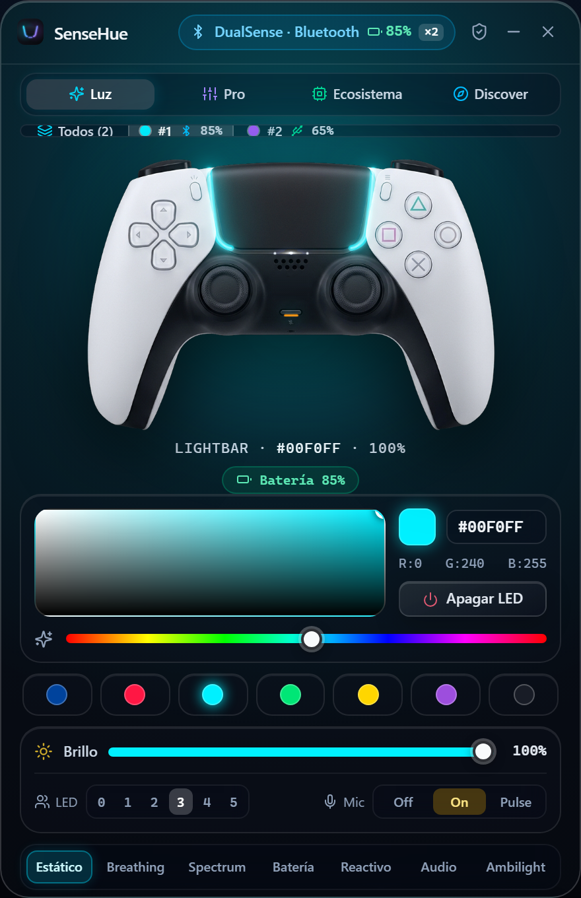
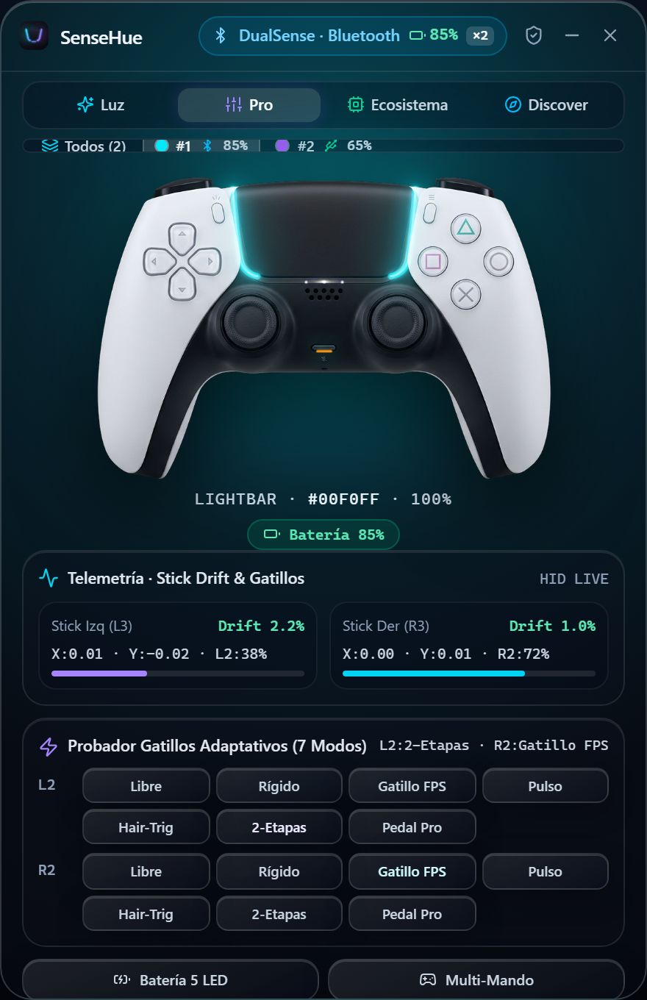
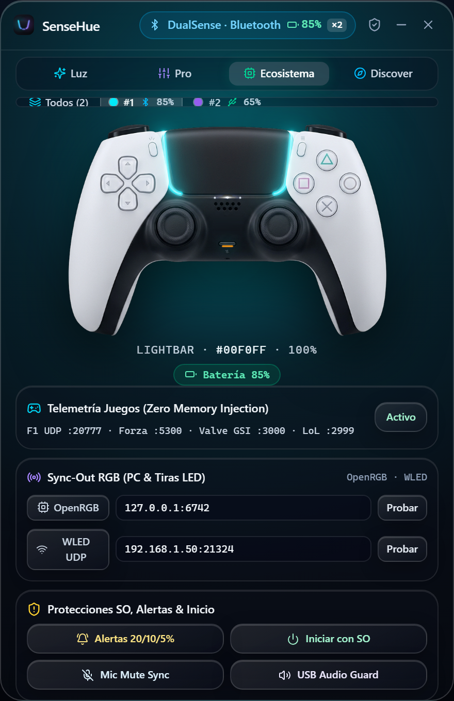
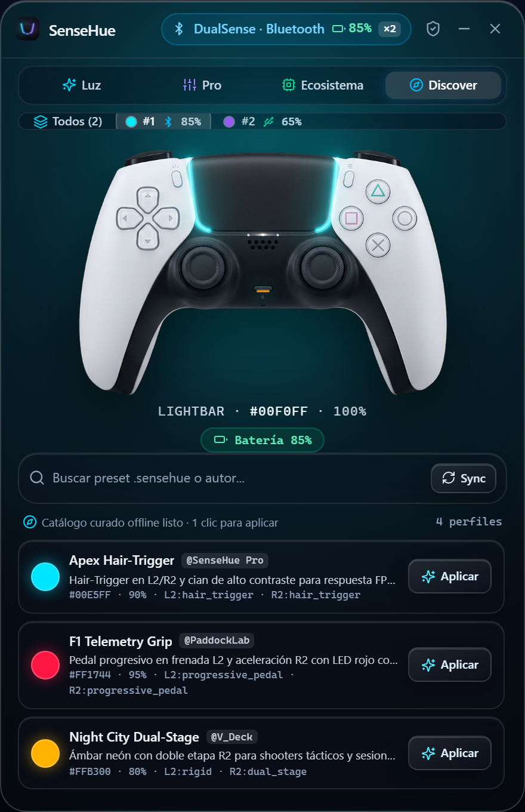
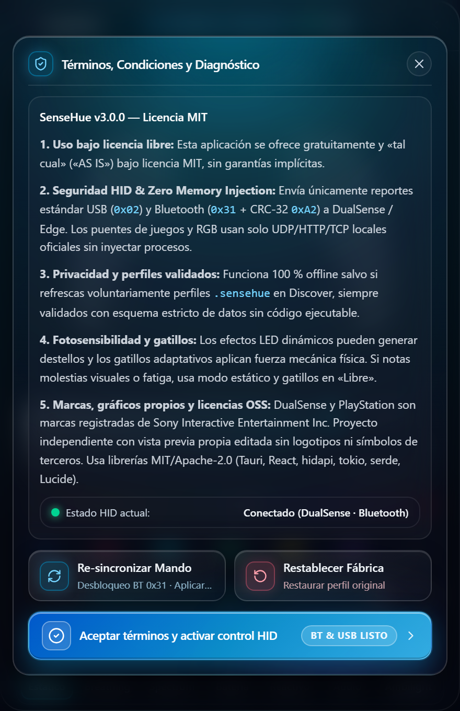
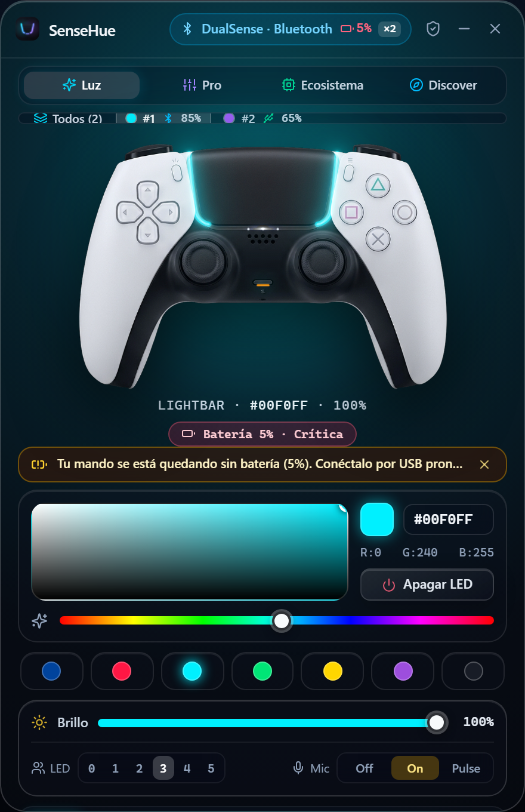

# SenseHue v3.0.0 — Complete English Documentation

Welcome to the complete user and technical guide for **SenseHue v3.0.0**, a lightweight, high-craft open-source desktop utility and CLI built with **Tauri v2**, **React 18**, and **Rust** to manage **DualSense** (`0x054C:0x0CE6`) and **DualSense Edge** (`0x054C:0x0DF2`) controllers over **USB-C** and **Bluetooth**.

---

## Table of Contents
1. [Key Features](#1-key-features)
2. [Installation & Distribution](#2-installation--distribution)
3. [Interface Walkthrough (All Sections)](#3-interface-walkthrough-all-sections)
4. [Multi-Controller & Single-Instance Behavior](#4-multi-controller--single-instance-behavior)
5. [Real Battery Telemetry & Dismissible Low-Battery Alerts](#5-real-battery-telemetry--dismissible-low-battery-alerts)
6. [Adaptive Triggers (7 Independent L2 / R2 Modes)](#6-adaptive-triggers-7-independent-l2--r2-modes)
7. [Zero Memory Injection Game Telemetry & RGB Sync](#7-zero-memory-injection-game-telemetry--rgb-sync)
8. [Command-Line Interface (`sensehue-cli`)](#8-command-line-interface-sensehue-cli)
9. [Architecture & Project Structure](#9-architecture--project-structure)
10. [Troubleshooting](#10-troubleshooting)
11. [Legal, Trademarks & Safety Notices](#11-legal-trademarks--safety-notices)

---

## 1. Key Features

- **100% Native Rust HID Communication**: Direct `hidapi` communication with DualSense & DualSense Edge over both USB-C (`Output Report 0x02`) and Bluetooth (`Output Report 0x31` signed with IEEE CRC-32 seed `0xA2` and automatic `Feature Report 0x05` / `0x20` extended-mode unlock).
- **Single-Instance Guard & Multi-Controller Hub**: Enforces a single desktop window (`tauri-plugin-single-instance`) while automatically enumerating every USB and Bluetooth controller simultaneously, letting you customize each pad independently or sync all at once.
- **Logo-Free Controller Visualizer**: Live interactive touchpad glow preview with zero third-party logos.
- **Real Hardware Battery & Smart Alerts**: Decodes raw HID battery bytes (`buf[53]` on USB, `buf[54]` on extended Bluetooth `0x31`) and triggers tiered alerts at **20%**, **10%**, and **5%** (dismissible with the `X` button or auto-dismissed after **5 seconds**).
- **7 Adaptive Trigger Profiles per Trigger**: Configure `L2` and `R2` independently, including clean hardware reset (`Off = 0x05`) so switching back to `Libre` immediately releases resistance.
- **Zero Memory Injection Integrations**: Listens strictly to official local sockets/APIs (F1 UDP, Forza UDP, Valve GSI, League of Legends Live Client API) plus OpenRGB SDK and WLED UDP sync.

---

## 2. Installation & Distribution

### Windows (`x86_64`)
1. **Standard Installer (Recommended)**: Run `SenseHue_3.0.0_x64-setup.exe`. It features a branded SenseHue installer experience and automatically creates Start Menu / Desktop shortcuts.
2. **Portable Executable**: Run `SenseHue.exe` directly from any folder with zero installation steps.
3. **CLI Binary**: Place `sensehue-cli.exe` in your `PATH` (or alongside the app) for scripts, hotkeys, and automated startup profiles.

### Linux & SteamOS
- Packages: `.deb`, `.AppImage`, `.rpm`, AUR / Flatpak definitions under `packaging/`.
- Standard HID access requires udev rules (`99-sensehue.rules`). See [LINUX_STEAMOS_SETUP.md](./LINUX_STEAMOS_SETUP.md) for non-root HID permissions on Steam Deck and desktop distros.

### Configuration Persistence
All global settings and `per_controller` lighting/trigger profiles are saved atomically (write temp file + rename) using standard OS app config paths (`directories` crate).

---

## 3. Interface Walkthrough (All Sections)

### Header & Connection Badge
- Displays **SenseHue** branding, active controller model + transport (`USB` or `Bluetooth`), real-time battery badge (`%`), and connected count (`x2`, etc.).
- **Top-right controls**:
  - **Shield Icon**: Opens **Terms, Conditions & HID Diagnostics** (`Acerca de / Términos`).
  - **Minimize (`_`)** / **Close (`×`)**: Optionally minimizes to the system tray (when `close_to_tray` is active) instead of quitting so background lighting & alerts stay running.

### Tab 1: `Luz` (Lighting Control)

- **Live Touchpad & Status Readout**: Shows active `#RRGGBB`, brightness `%`, and color-coded battery pill.
- **2D Saturation/Value Color Pad + Hue Slider**: Smooth continuous HSV picking with instant live preview on hardware.
- **HEX Input & RGB Readout + `Apagar LED`**: Type any `#RRGGBB` value or shut off the lightbar in one click.
- **7 Quick Curated Presets**: `Classic Blue`, `Crimson Red`, `Cyber Cyan`, `Emerald`, `Gold`, `Violet`, and `Apagado`.
- **Brightness Slider (`0–100%`)**, **Player Indicator LEDs (`0–5`)**, and **Mic LED (`Off / On / Pulse`)**.
- **7 Lighting Modes**:
  - `Estático` (Solid RGB)
  - `Breathing` (Smooth sinusoidal pulse)
  - `Spectrum` (Continuous rainbow cycle)
  - `Batería` (Dynamic color mapped to real controller battery level)
  - `Reactivo` (Reacts to analog stick & trigger inputs)
  - `Audio` (Beat/envelope reactive lighting)
  - `Ambilight` (Screen-sampling edge color sync)
- **Quick Behavior Switches**:
  - `Auto-aplicar` (`apply_on_connect`): Automatically restores your saved lighting & trigger profile as soon as a controller connects.
  - `Steam Fix` (`keep_alive_steam`): Periodically re-asserts your custom lightbar profile if Steam Input overrides controller LEDs.
  - `Cerrar a tray` (`close_to_tray`): Minimizes SenseHue to the system tray on window close so dynamic effects and low-battery alerts keep running cleanly.

### Tab 2: `Pro` (Telemetry, Diagnostics & Adaptive Triggers)

- **Stick Drift & Trigger Telemetry (`HID LIVE`)**: Displays real-time normalized `L3` (`X/Y`) and `R3` (`X/Y`) coordinates, calculated center drift percentage, and live `L2%` / `R2%` analog travel bars.
- **Adaptive Trigger Tester (7 Modes per L2 & R2)**: Header summarizes `L2:<mode> · R2:<mode>` while tactile buttons configure each trigger independently.
- **Hardware Toggles**:
  - `Batería 5 LED`: Mirrors charge level onto the 5 center-out player indicator LEDs under the touchpad.
  - `Multi-Mando`: Toggles simultaneous sync across all connected controllers (`sync_all_controllers`).
  - `Gyro Aim`: Subtle visual confirmation tint when gyro aiming is active.
  - `.sensehue` JSON profile export & import.

### Tab 3: `Ecosistema` (Game Telemetry, RGB Sync & OS Protections)

- **Game Telemetry (Zero Memory Injection)**:
  - **F1 UDP**: `20777`
  - **Forza Data Out UDP**: `5300`
  - **Valve GSI (CS2 / Dota 2 HTTP)**: `127.0.0.1:3000`
  - **League of Legends Live Client API**: `127.0.0.1:2999`
- **Sync-Out RGB (PC & LED Strips)**:
  - **OpenRGB SDK**: TCP (`127.0.0.1:6742` default) + instant `Probar` connectivity check.
  - **WLED Realtime UDP**: DRGB UDP (`192.168.1.50:21324` example) + `Probar` button.
- **OS Protections, Alerts & Startup**:
  - `Alertas 20/10/5%`: Enables low-battery desktop notifications & in-app alerts.
  - `Iniciar con SO`: Registers/unregisters OS autostart (`tauri-plugin-autostart`).
  - `Mic Mute Sync`: Synchronizes hardware mute button press with mic LED state.
  - `USB Audio Guard`: Protects Windows/Linux audio routing when DualSense USB audio enumerates.

### Tab 4: `Discover` (Curated `.sensehue` Community Profiles)

- Offline-ready curated presets bundled inside the app (e.g., *Apex Hair-Trigger*, *F1 Telemetry Grip*, *Night City Dual-Stage*).
- Live search filter by profile name or author, plus optional `Sync` refresh from JSON registries.
- Strictly schema-validated configuration payloads (zero executable code/scripts).

### Terms, Conditions & HID Recovery Modal

- Accessible from the header shield icon at any time.
- Shows live HID transport connection state.
- **Re-sincronizar Mando**: Re-runs Bluetooth extended unlock (`0x05` / `0x20`) and re-applies active state.
- **Restablecer Fábrica**: Resets lighting, triggers, and preferences to defaults.

---

## 4. Multi-Controller & Single-Instance Behavior

### Single-Instance Focus Routing
Opening SenseHue a second time (for instance from a shortcut while already minimized to tray) passes focus cleanly to the running instance (`tauri-plugin-single-instance`), prevents conflicting HID writers on the same controller handles, and surfaces the existing window.

### Multi-Controller Switching (`Todos` vs Individual Slots)
- When two or more controllers are connected (any mix of USB and Bluetooth), the **Controller Switcher** bar appears below the tabs (`Todos (N)`, `#1`, `#2`, ...).
- Selecting **#1** or **#2** edits that controller's dedicated profile (`per_controller[id]`), preserving different colors and trigger profiles per controller.
- Enabling **Todos** (`sync_all_controllers = true`) broadcasts every change across all connected DualSense / DualSense Edge controllers simultaneously.
- Each HID handle operates through clean error isolation: unplugging one controller logs and removes only that device without interrupting remaining controllers.

---

## 5. Real Battery Telemetry & Dismissible Low-Battery Alerts



### How Real Battery Is Decoded
- **USB (`Input Report 0x01`)**: Reads byte `53`. Low nibble `0x0..0x9` maps to `(nibble * 10 + 5)%` (`5%, 15%, ..., 95%`, clamped `100%` when `>= 10` or full); high nibble `(byte >> 4) & 0x0F` decodes charging status (`0` = Discharging, `1` = Charging, `2` = Full).
- **Bluetooth (`Input Report 0x31`, >= 55 bytes)**: Reads byte `54` using the same dual-nibble format after unlocking extended reporting via Feature Report `0x05` (with automatic `0x20` fallback).
- The HID reader drains any queued legacy `0x01` Bluetooth packets (up to 16 frames) and automatically re-triggers extended wakeup if telemetry is missing.

### Alert Thresholds & Dismissal (`X` or 5 Seconds)
- Alerts fire once per discharge threshold crossing at **20%**, **10%**, and **5%**, resetting cleanly once recharged above **25%**.
- Each in-app notification banner provides an explicit **`X`** close button for immediate dismissal and automatically closes **5 seconds (`5000ms`)** after appearing.

---

## 6. Adaptive Triggers (7 Independent L2 / R2 Modes)

DualSense triggers expect an 11-byte effect descriptor written to payload offsets `+10..+21` (**R2**) and `+21..+32` (**L2**), guarded by `valid_flag0` bits `0x04` (R2) and `0x08` (L2). SenseHue always programs both trigger descriptors on full output reports so returning to `Libre` sends `[0x05, 0, ...]` (`Off`) to release mechanical motor resistance immediately.

| UI Label | Internal Preset | Firmware Opcode | Behavior |
| :--- | :--- | :---: | :--- |
| **Libre** | `off` | `0x05` | Completely releases trigger motor (zero resistance). |
| **Rígido** | `rigid` | `0x01` | Constant heavy resistance across the full trigger pull (`0x00, 0xFF`). |
| **Gatillo FPS** | `weapon_click` | `0x02` | Tactile crisp break-point wall from zone `0x38` to `0x70` at full force (`0xFF`). |
| **Pulso** | `pulse` | `0x06` | Rapid rhythmic vibration pulse starting near `0x14` (`amp 0x3F`, `freq 0x30`). |
| **Hair-Trig** | `hair_trigger` | `0x02` | Early activation stop (`0x20..0x45`, `0xFF`) for rapid competitive tap response. |
| **2-Etapas** | `dual_stage` | `0x02` | Light pre-travel followed by a late resistance wall (`0x78..0xA4`, `0xFF`). |
| **Pedal Pro** | `progressive_pedal` | `0x01` | Smooth progressive pedal tension starting from `0x28` (`force 0x98`). |

---

## 7. Zero Memory Injection Game Telemetry & RGB Sync

SenseHue **never injects DLLs** and **never reads another process's memory**:
- **Game Telemetry (`src-tauri/src/game/`)**: Listens on local loopback ports (`F1 :20777`, `Forza :5300`, `Valve GSI :3000`, `LoL :2999`) or matches active process names/Steam App IDs (`DEFAULT_GAME_PROFILES`) to shift lighting dynamically without touching game binaries or triggering anti-cheat systems.
- **External RGB (`src-tauri/src/ecosystem/`)**:
  - `openrgb_client.rs`: Speaks binary `ORGB` packets to a running OpenRGB SDK server (`TCP 6742`).
  - `wled_udp.rs`: Broadcasts `DRGB` realtime UDP packets (`UDP 21324`) to ESP8266/ESP32 WLED strips.
  - `local_server.rs`: Optional disabled-by-default loopback HTTP API on `127.0.0.1:17420`.

---

## 8. Command-Line Interface (`sensehue-cli`)

`sensehue-cli` shares the exact same Rust `ControllerService` and HID protocol engine as the GUI:

```powershell
# Show connected controllers, transport, real battery %, charging state, and saved color
sensehue-cli --status

# Apply a curated preset
sensehue-cli --preset cyber-cyan

# Set a custom HEX color with brightness percentage
sensehue-cli --color "#FF1744" --brightness 75

# Switch lighting mode
sensehue-cli --mode battery
sensehue-cli --mode breathing --brightness 60

# Turn off lightbar LEDs
sensehue-cli --off

# Print usage help
sensehue-cli --help
```

---

## 9. Architecture & Project Structure

```text
DualSenseColour/
├── src/                         # React 18 + TypeScript + Tailwind v4 UI
│   ├── App.tsx                  # Main window shell, tabs, dismissible battery alert banner
│   ├── hooks/useController.ts   # Tauri IPC bridge, monotonic trigger sequence guard, state sync
│   ├── components/              # DualSensePreview, ColorControls, DiagnosticsPanel, EcosystemPanel, DiscoverPanel, ControllerSwitcher, TermsModal
│   └── types/controller.ts      # Shared IPC DTOs & builtin preset definitions
├── src-tauri/                   # Rust backend & Tauri v2 host
│   ├── src/hid/
│   │   ├── protocol.rs          # USB 0x02 (63B) & BT 0x31 (78B + CRC32 0xA2) packet builders
│   │   ├── triggers.rs          # 7 adaptive trigger descriptors & player LED battery bar mapping
│   │   ├── input_report.rs      # Real USB/BT battery, charging state, sticks & trigger parser
│   │   ├── transport.rs         # RealHidTransport (hidapi) + MockHidTransport for deterministic tests
│   │   ├── monitor.rs           # Async tokio hotplug & telemetry polling loop
│   │   └── battery_alerts.rs    # Hysteresis tracker for 20% / 10% / 5% alerts
│   ├── src/commands.rs          # Multi-controller ControllerService & Tauri invoke commands
│   ├── src/config.rs            # Atomic JSON config persistence + per-controller profiles
│   ├── src/effects.rs           # Static, breathing, spectrum, battery, reactive, audio, ambilight engines
│   ├── src/tray.rs              # Dynamic color tray icon & live battery tray status
│   ├── src/game/                # Zero-injection F1, Forza, Valve GSI, LoL & game profile watchers
│   ├── src/ecosystem/           # OpenRGB SDK client, WLED UDP emitter & local HTTP loopback API
│   └── src/bin/sensehue_cli.rs  # Standalone CLI binary
├── docs/                        # English & Spanish docs, HID protocol spec, Linux setup, screenshots
└── packaging/                   # AUR, Flatpak, udev rules, Winget manifests
```

---

## 10. Troubleshooting

- **Bluetooth controller stays white or ignores color changes**:
  - Open the shield icon modal and click **Re-sincronizar Mando**, or run `sensehue-cli --status`. SenseHue automatically performs `Feature Report 0x05` / `0x20` extended wakeup; if Steam Input or DS4Windows holds exclusive HID control, close competing tools or enable SenseHue's Steam keep-alive behavior.
- **Triggers still feel stiff after closing a game**:
  - Switch `L2` / `R2` to **Libre** in the `Pro` tab. SenseHue explicitly transmits `[0x05, 0, ...]` with `VALID_FLAG0` enabled on every full packet so motors disengage immediately.
- **Battery percentage shows `None` over Bluetooth**:
  - Wait 1–2 seconds for the controller's extended `0x31` input stream after BT wakeup, or ensure the controller isn't locked exclusively in legacy `0x01` mode by another utility.
- **Second controller shows separate color**:
  - Toggle **Multi-Mando** (`Todos`) in the Controller Switcher or `Pro` tab if you want synchronized colors instead of per-controller profiles.
- **Linux permissions (`Permission denied` on `/dev/hidraw*`)**:
  - Install `packaging/linux/99-sensehue.rules` into `/etc/udev/rules.d/` and reload udev rules (`sudo udevadm control --reload-rules && sudo udevadm trigger`).

---

## 11. Legal, Trademarks & Safety Notices

- **License**: Released under the **MIT License** (`AS IS`, without warranty). See [LICENSE](../LICENSE) and [TERMS_AND_CONDITIONS.txt](../TERMS_AND_CONDITIONS.txt).
- **Trademarks**: "PlayStation", "PS5", and "DualSense" are registered trademarks of Sony Interactive Entertainment Inc., cited strictly under nominative descriptive fair use to indicate compatibility. SenseHue is an independent project and is **not** affiliated with, endorsed by, or sponsored by Sony Interactive Entertainment Inc. No official Sony/PlayStation brand logos are included in the app, preview render, installer, or documentation.
- **Photosensitivity & Trigger Resistance**: Rapid dynamic lighting effects and mechanical adaptive trigger forces may cause discomfort or fatigue for some users. Switch to `Estático` and set triggers to `Libre` immediately if any discomfort occurs.
