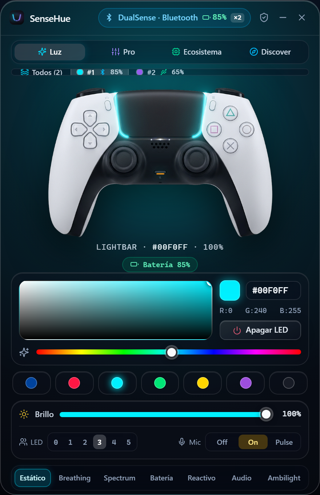
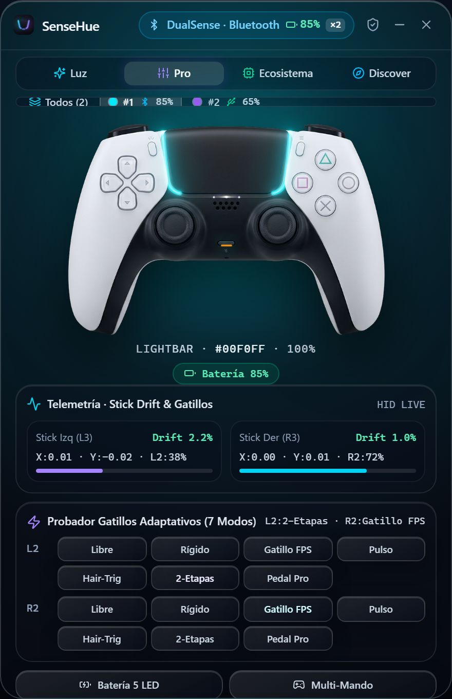
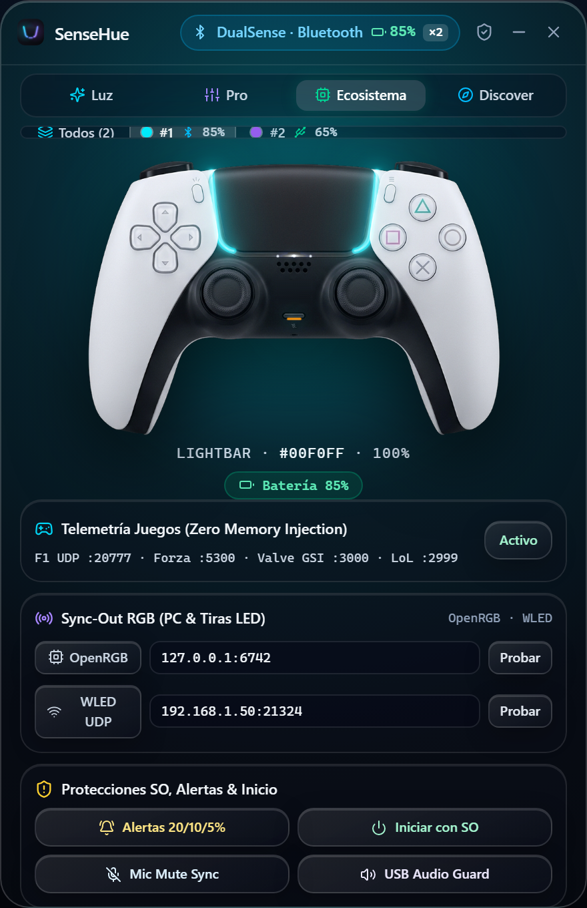
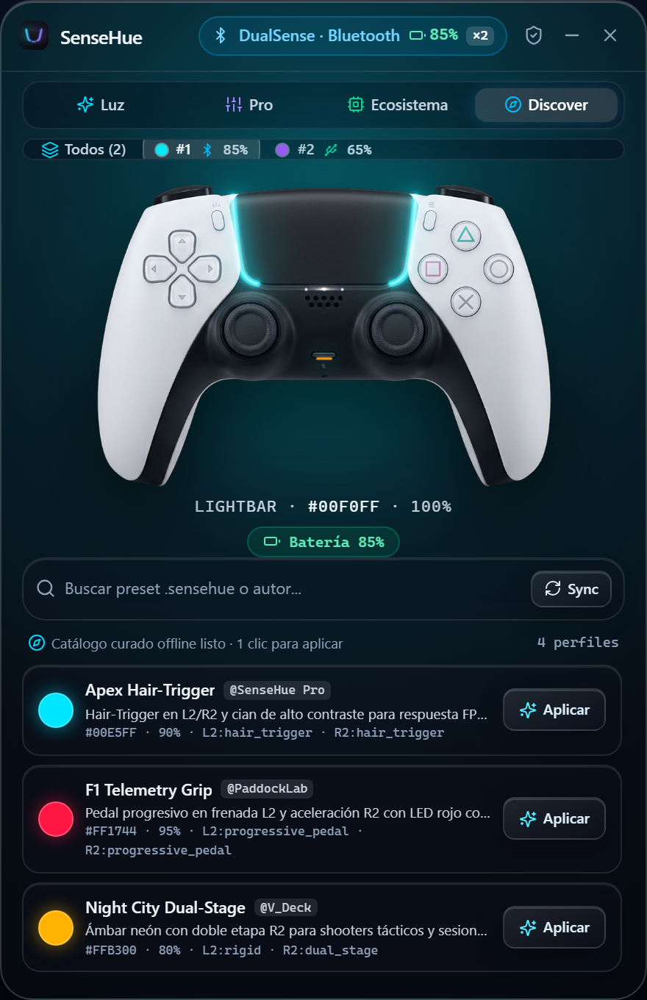
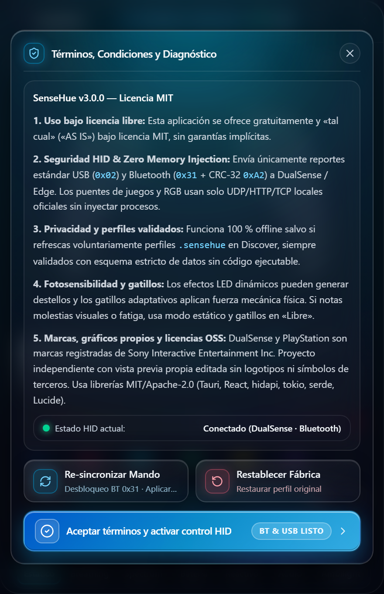
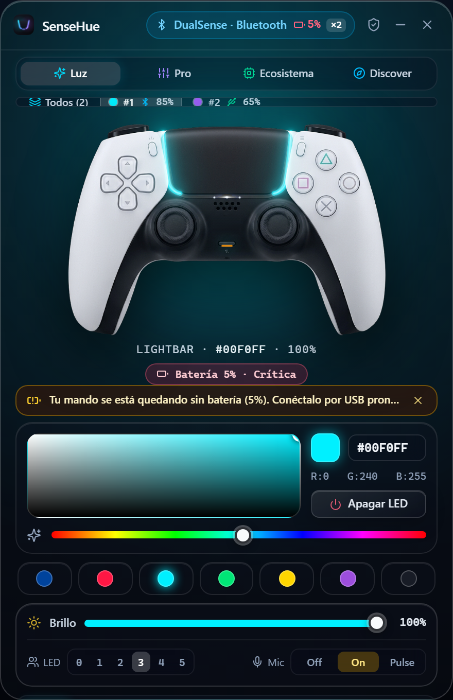

# SenseHue v3.0.0 — Documentación Completa (Español)

Bienvenido a la guía completa de usuario y arquitectura de **SenseHue v3.0.0**, una utilidad de escritorio y CLI ligera, rápida y open-source desarrollada con **Tauri v2**, **React 18** y **Rust** para gestionar mandos **DualSense** (`0x054C:0x0CE6`) y **DualSense Edge** (`0x054C:0x0DF2`) mediante **USB-C** y **Bluetooth**.

---

## Índice de Contenidos
1. [Características Principales](#1-características-principales)
2. [Instalación y Distribución](#2-instalación-y-distribución)
3. [Recorrido por la Interfaz (Todos los Apartados)](#3-recorrido-por-la-interfaz-todos-los-apartados)
4. [Soporte Multi-Mando e Instancia Única](#4-soporte-multi-mando-e-instancia-única)
5. [Batería Real HID y Alertas Descartables (`X` o 5 segundos)](#5-batería-real-hid-y-alertas-descartables-x-o-5-segundos)
6. [Gatillos Adaptativos (7 Modos Independientes en L2 / R2)](#6-gatillos-adaptativos-7-modos-independientes-en-l2--r2)
7. [Telemetría de Juegos (Zero Memory Injection) y Sync RGB](#7-telemetría-de-juegos-zero-memory-injection-y-sync-rgb)
8. [Interfaz de Línea de Comandos (`sensehue-cli`)](#8-interfaz-de-línea-de-comandos-sensehue-cli)
9. [Arquitectura y Estructura del Proyecto](#9-arquitectura-y-estructura-del-proyecto)
10. [Solución de Problemas (Troubleshooting)](#10-solución-de-problemas-troubleshooting)
11. [Aviso Legal, Marcas y Seguridad](#11-aviso-legal-marcas-y-seguridad)

---

## 1. Características Principales

- **Protocolo HID Nativo en Rust**: Comunicación directa mediante `hidapi` con DualSense y DualSense Edge por USB-C (`Output Report 0x02`) y Bluetooth (`Output Report 0x31` firmado con CRC-32 semilla `0xA2` y desbloqueo automático mediante `Feature Report 0x05` / `0x20`).
- **Instancia Única y Centro Multi-Mando**: Impide ejecutar ventanas duplicadas (`tauri-plugin-single-instance`) mientras detecta simultáneamente varios mandos conectados por USB o Bluetooth, permitiendo configurar cada uno por separado o sincronizarlos todos a la vez.
- **Vista Previa Propia sin Logotipos de Terceros**: Render limpio del mando con iluminación reactiva en tiempo real y sin logos registrados.
- **Batería Real y Alertas Inteligentes**: Decodifica los bytes reales de batería HID (`buf[53]` en USB, `buf[54]` en Bluetooth extendido `0x31`) y muestra avisos al **20%**, **10%** y **5%** que pueden cerrarse pulsando **`X`** o se ocultan automáticamente tras **5 segundos**.
- **7 Modos de Gatillos Adaptativos en L2 y R2**: Control independiente para cada gatillo con reseteo explícito al firmware (`0x05` = `Libre`) para liberar los motores de resistencia al instante.
- **Integraciones Sin Inyección de Memoria**: Escucha exclusivamente sockets y APIs locales oficiales (F1 UDP, Forza UDP, Valve GSI, League of Legends Live API) junto a OpenRGB y WLED.

---

## 2. Instalación y Distribución

### Windows (`x86_64`)
1. **Instalador Estándar (Recomendado)**: Ejecuta `SenseHue_3.0.0_x64-setup.exe`. Incluye experiencia personalizada de marca SenseHue, integración con el menú Inicio / Escritorio y desinstalador limpio.
2. **Versión Portable**: Ejecuta `SenseHue.exe` directamente desde cualquier carpeta sin instalar nada.
3. **Binario CLI**: Añade `sensehue-cli.exe` a tu `PATH` (o úsalo desde terminal) para scripts, atajos y perfiles automáticos.

### Linux y SteamOS
- Paquetes disponibles: `.deb`, `.AppImage`, `.rpm` y manifiestos bajo `packaging/`.
- Para acceso HID sin permisos de administrador, instala la regla udev (`99-sensehue.rules`) descrita en [LINUX_STEAMOS_SETUP.md](./LINUX_STEAMOS_SETUP.md).

### Persistencia de Configuración
Toda la configuración global y los perfiles individuales por mando (`per_controller`) se guardan de forma atómica (escritura en archivo temporal + renombrado) en la ruta estándar del sistema operativo.

---

## 3. Recorrido por la Interfaz (Todos los Apartados)

### Barra Superior y Estado de Conexión
- Muestra el logotipo de **SenseHue**, el modelo conectado, el transporte (`USB` o `Bluetooth`), el porcentaje real de batería y un indicador de múltiples mandos (`x2`, etc.).
- **Botones superiores derechos**:
  - **Escudo**: Abre el modal de **Términos, Condiciones y Diagnóstico HID** (`Acerca de`).
  - **Minimizar (`_`)** / **Cerrar (`×`)**: Con `close_to_tray` activo, minimiza a la bandeja del sistema manteniendo efectos y alertas en segundo plano.

### Pestaña 1: `Luz` (Iluminación)

- **Vista Previa del Mando**: Refleja color HEX, brillo `%` y píldora de batería en tiempo real.
- **Selector HSV 2D + Barra de Tono (Hue)**: Selección fluida con actualización instantánea en el hardware.
- **Entrada HEX, Lectura RGB y `Apagar LED`**: Introduce cualquier código `#RRGGBB` o apaga la barra LED con un clic.
- **7 Presets Rápidos**: `Classic Blue`, `Crimson Red`, `Cyber Cyan`, `Emerald`, `Gold`, `Violet` y `Apagado`.
- **Control de Brillo (`0–100%`)**, **LEDs de Jugador (`0–5`)** y **LED de Micrófono (`Off / On / Pulse`)**.
- **7 Modos de Iluminación**:
  - `Estático` (Color sólido)
  - `Breathing` (Respiración suave)
  - `Spectrum` (Ciclo arcoíris continuo)
  - `Batería` (Color dinámico según porcentaje real de batería)
  - `Reactivo` (Responde a movimientos de sticks y gatillos)
  - `Audio` (Reacciona a picos de audio)
  - `Ambilight` (Sincronización con color dominante de pantalla)
- **Preferencias Rápidas**:
  - `Auto-aplicar` (`apply_on_connect`): Reaplica automáticamente el color y perfil guardado nada más conectar el mando.
  - `Steam Fix` (`keep_alive_steam`): Reafirma periódicamente la iluminación cuando Steam Input intenta sobreescribir el LED por defecto.
  - `Cerrar a tray` (`close_to_tray`): Envía la app a la bandeja del sistema al cerrar la ventana para mantener activos los efectos y alertas de batería.

### Pestaña 2: `Pro` (Telemetría, Diagnóstico y Gatillos Adaptativos)

- **Telemetría Stick Drift & Gatillos (`HID LIVE`)**: Muestra ejes `X / Y` normalizados de `Stick Izq (L3)` y `Stick Der (R3)`, porcentaje de deriva (*drift*) en reposo y recorrido analógico en tiempo real de `L2%` y `R2%`.
- **Probador de Gatillos Adaptativos (7 Modos para L2 y R2)**: Cabecera en tiempo real `L2:<modo> · R2:<modo>` y botones táctiles independientes por gatillo.
- **Opciones Pro**:
  - `Batería 5 LED`: Convierte los 5 LEDs de jugador bajo el touchpad en una barra física de batería.
  - `Multi-Mando`: Sincroniza el perfil actual en todos los mandos conectados simultáneamente (`sync_all_controllers`).
  - `Gyro Aim`: Indicador visual sutil en la barra LED cuando el giroscopio está activo.
  - Exportación e importación de perfiles `.sensehue` en JSON.

### Pestaña 3: `Ecosistema` (Juegos, Sync RGB y Protecciones)

- **Telemetría de Juegos (Zero Memory Injection)**:
  - **F1 UDP**: puerto `20777`
  - **Forza Data Out UDP**: puerto `5300`
  - **Valve GSI (CS2 / Dota 2 HTTP)**: `127.0.0.1:3000`
  - **League of Legends Live Client API**: `127.0.0.1:2999`
- **Sync-Out RGB (PC y Tiras LED)**:
  - **OpenRGB SDK**: TCP (`127.0.0.1:6742`) con botón `Probar`.
  - **WLED Realtime UDP**: protocolo `DRGB` (`192.168.1.50:21324` editable) con botón `Probar`.
- **Protecciones SO, Alertas e Inicio**:
  - `Alertas 20/10/5%`: Activa alertas de batería baja en pantalla y en el sistema operativo.
  - `Iniciar con SO`: Configura el arranque automático con Windows/Linux.
  - `Mic Mute Sync`: Sincroniza pulsaciones del botón físico Mute con el LED naranja.
  - `USB Audio Guard`: Evita que Windows secuestre el dispositivo de audio al conectar el mando por USB.

### Pestaña 4: `Discover` (Catálogo de Perfiles `.sensehue`)

- Catálogo integrado listo para funcionar 100 % offline (*Apex Hair-Trigger*, *F1 Telemetry Grip*, *Night City Dual-Stage*, etc.).
- Barra de búsqueda instantánea por nombre o autor y botón `Sync` opcional para actualizar registros comunitarios.
- Validación estricta de esquema JSON: solo parámetros de configuración, sin scripts ni código ejecutable.

### Modal de Términos, Condiciones y Diagnóstico HID

- Accesible desde el icono de escudo superior derecho.
- Muestra el estado en vivo del transporte HID.
- **Re-sincronizar Mando**: Fuerza el desbloqueo Bluetooth (`0x05` / `0x20`) y reenvía el estado activo.
- **Restablecer Fábrica**: Restaura configuración inicial segura (luz predeterminada y gatillos en `Libre`).

---

## 4. Soporte Multi-Mando e Instancia Única

### Bloqueo de Instancia Única (`Single Instance`)
Al intentar abrir una segunda copia de `SenseHue.exe`, `tauri-plugin-single-instance` intercepta el lanzamiento, restaura y enfoca la ventana original y evita colisiones de escritura HID sobre los mismos mandos.

### Conmutador Multi-Mando (`Todos` vs `#1`, `#2`…)
- Al conectar 2 o más mandos (USB, Bluetooth o mixtos), aparece la barra de selección bajo las pestañas (`Todos (N)`, `#1`, `#2`…).
- Si eliges **#1** o **#2**, editas de forma independiente el perfil propio de ese mando (`per_controller[id]`) — ideal para tener distinto color o distinto modo de gatillos por jugador.
- Al activar **Todos** (`sync_all_controllers`), cualquier ajuste se aplica de golpe a todos los mandos conectados.
- Si desconectas un mando en caliente, su bucle de monitoreo se cierra de forma aislada sin afectar a los demás.

---

## 5. Batería Real HID y Alertas Descartables (`X` o 5 segundos)



### Lectura Real de Batería USB y Bluetooth
- **USB (`Input Report 0x01`)**: Lee el byte `53`. El nibble inferior (`0..9`) se convierte en `(nibble * 10 + 5)%` (`5%, 15%, ..., 95%`, o `100%` en estado Full/`>= 10`), y el nibble superior indica carga (`Discharging`, `Charging`, `Full`).
- **Bluetooth (`Input Report 0x31`, `>= 55` bytes)**: Lee el byte `54` con la misma codificación tras despertar el reporte extendido mediante `Feature Report 0x05` (con fallback a `0x20`).
- El lector drena automáticamente paquetes `0x01` antiguos en cola (hasta 16 tramas) y reintenta el despertar Bluetooth si la telemetría aún no ha llegado.

### Umbrales de Alerta y Cierre (`X` / 5 s)
- Dispara alertas una sola vez al cruzar a la baja **20%**, **10%** y **5%**, reiniciando la histéresis al superar el **25%**.
- El aviso flotante en la app dispone de botón **`X`** para cerrarlo en cualquier momento y además desaparece automáticamente **5 segundos (`5000ms`)** después de aparecer.

---

## 6. Gatillos Adaptativos (7 Modos Independientes en L2 / R2)

Cada paquete completo de salida escribe ambos descriptores de 11 bytes (`+10..+21` para **R2** y `+21..+32` para **L2**) activando `VALID_FLAG0` (`0x04 | 0x08 = 0x0C`). De este modo, al volver a seleccionar **Libre**, SenseHue envía siempre `[0x05, 0, ...]` para desactivar el motor del gatillo inmediatamente.

| Etiqueta UI | Preset Interno | Opcode | Comportamiento Físico |
| :--- | :--- | :---: | :--- |
| **Libre** | `off` | `0x05` | Libera por completo el motor (sin resistencia). |
| **Rígido** | `rigid` | `0x01` | Resistencia continua máxima en todo el recorrido (`0x00, 0xFF`). |
| **Gatillo FPS** | `weapon_click` | `0x02` | Tope seco táctil tipo arma entre zona `0x38` y `0x70` (`0xFF`). |
| **Pulso** | `pulse` | `0x06` | Vibración rítmica continua en gatillo (`0x14`, amplitud `0x3F`, freq `0x30`). |
| **Hair-Trig** | `hair_trigger` | `0x02` | Activación ultra corta al principio (`0x20..0x45`, `0xFF`) para shooters. |
| **2-Etapas** | `dual_stage` | `0x02` | Recorrido inicial suave seguido de clic firme tardío (`0x78..0xA4`, `0xFF`). |
| **Pedal Pro** | `progressive_pedal` | `0x01` | Tensión progresiva constante tipo pedal de freno/acelerador (`0x28`, `0x98`). |

---

## 7. Telemetría de Juegos (Zero Memory Injection) y Sync RGB

SenseHue **no inyecta DLLs** ni **lee la memoria** de ningún juego:
- **Telemetría de Juegos**: Escucha sockets loopback locales (`F1 :20777`, `Forza :5300`, `Valve GSI :3000`, `LoL :2999`) o detecta procesos/AppIDs para adaptar colores sin riesgo con sistemas anti-cheat.
- **Sync RGB Externo**:
  - `openrgb_client.rs`: Cliente binario `ORGB` sobre TCP (`6742`).
  - `wled_udp.rs`: Emisor UDP `DRGB` (`21324`) para tiras LED WLED.
  - `local_server.rs`: API HTTP local opcional en `127.0.0.1:17420` (desactivada por defecto).

---

## 8. Interfaz de Línea de Comandos (`sensehue-cli`)

Comparte exactamente el mismo motor `ControllerService` y protocolo HID de la interfaz gráfica:

```powershell
# Ver mandos conectados, transporte, batería real %, carga y estado guardado
sensehue-cli --status

# Aplicar un preset predefinido
sensehue-cli --preset cyber-cyan

# Aplicar color HEX personalizado y brillo
sensehue-cli --color "#FF1744" --brightness 75

# Cambiar modo de iluminación
sensehue-cli --mode battery
sensehue-cli --mode breathing --brightness 60

# Apagar la barra LED
sensehue-cli --off

# Mostrar ayuda
sensehue-cli --help
```

---

## 9. Arquitectura y Estructura del Proyecto

```text
SenseHue/
├── src/                         # Interfaz React 18 + TypeScript + Tailwind v4
│   ├── App.tsx                  # Shell frameless, pestañas y banner descartable de batería
│   ├── hooks/useController.ts   # Puente IPC con Tauri, control secuencial de gatillos y refs síncronas
│   ├── components/              # DualSensePreview, ColorControls, DiagnosticsPanel, EcosystemPanel, DiscoverPanel, ControllerSwitcher, TermsModal
│   └── types/controller.ts      # Tipos IPC compartidos y presets por defecto
├── src-tauri/                   # Backend Rust & Tauri v2
│   ├── src/hid/
│   │   ├── protocol.rs          # Constructores USB 0x02 (63B) y BT 0x31 (78B + CRC32 0xA2)
│   │   ├── triggers.rs          # 7 descriptores de gatillos adaptativos y barra batería 5 LED
│   │   ├── input_report.rs      # Decodificador de batería USB/BT, carga, sticks y gatillos
│   │   ├── transport.rs         # RealHidTransport (hidapi) y MockHidTransport para tests
│   │   ├── monitor.rs           # Bucle async tokio de hotplug y telemetría
│   │   └── battery_alerts.rs    # Histéresis para alertas de 20% / 10% / 5%
│   ├── src/commands.rs          # ControllerService multi-mando y comandos invoke de Tauri
│   ├── src/config.rs            # Persistencia atómica JSON + perfiles per_controller
│   ├── src/effects.rs           # Motores static, breathing, spectrum, battery, reactive, audio, ambilight
│   ├── src/tray.rs              # Icono dinámico en bandeja del sistema y resumen de batería
│   ├── src/game/                # Clientes UDP/HTTP F1, Forza, Valve GSI, LoL y reglas de juego
│   ├── src/ecosystem/           # Cliente OpenRGB, emisor WLED UDP y API local loopback
│   └── src/bin/sensehue_cli.rs  # Binario CLI independiente
├── docs/                        # Documentación EN/ES, especificación HID, guía Linux y capturas
└── packaging/                   # Manifiestos AUR, Flatpak, reglas udev y Winget
```

---

## 10. Solución de Problemas (Troubleshooting)

- **El mando por Bluetooth permanece blanco o ignora cambios de color**:
  - Abre el modal del icono escudo y pulsa **Re-sincronizar Mando**, o ejecuta `sensehue-cli --status`. SenseHue envía automáticamente el desbloqueo `Feature Report 0x05` / `0x20`. Si otra app (p. ej. DS4Windows o Steam Input en modo exclusivo) retiene el dispositivo, ciérrala temporalmente.
- **Los gatillos siguen duros después de cerrar un juego**:
  - Selecciona **Libre** en `L2` / `R2` dentro de la pestaña `Pro`. SenseHue envía explícitamente `[0x05, 0, ...]` con `VALID_FLAG0` activo en cada paquete completo para soltar los motores al instante.
- **La batería aparece vacía al conectar por Bluetooth**:
  - Espera 1–2 segundos tras emparejar para recibir los primeros paquetes extendidos `0x31`. Si continúa, pulsa **Re-sincronizar Mando**.
- **Dos mandos muestran colores diferentes**:
  - Activa **Multi-Mando** (`Todos`) si quieres unificar ambos mandos; si prefieres perfiles independientes por jugador, deja `Multi-Mando` desactivado y selecciona `#1` o `#2`.
- **Permisos en Linux (`Permission denied` en `/dev/hidraw*`)**:
  - Copia `packaging/linux/99-sensehue.rules` en `/etc/udev/rules.d/` y recarga reglas (`sudo udevadm control --reload-rules && sudo udevadm trigger`).

---

## 11. Aviso Legal, Marcas y Seguridad

- **Licencia**: Distribuido bajo **Licencia MIT** («AS IS», sin garantías). Consulta [LICENSE](../LICENSE) y [TERMS_AND_CONDITIONS.txt](../TERMS_AND_CONDITIONS.txt).
- **Marcas Registradas**: «PlayStation», «PS5» y «DualSense» son marcas registradas de Sony Interactive Entertainment Inc., citadas únicamente de forma descriptiva (uso nominativo) para indicar compatibilidad hardware. SenseHue es un proyecto independiente **sin afiliación ni respaldo** de Sony Interactive Entertainment Inc., y no incluye logotipos oficiales ni iconos de marca de terceros.
- **Fotosensibilidad y Resistencia Mecánica**: Los efectos dinámicos rápidos y los modos de resistencia física en gatillos pueden provocar fatiga o molestias en usuarios sensibles. Cambia a modo `Estático` y gatillos en `Libre` si notas cualquier molestia.
